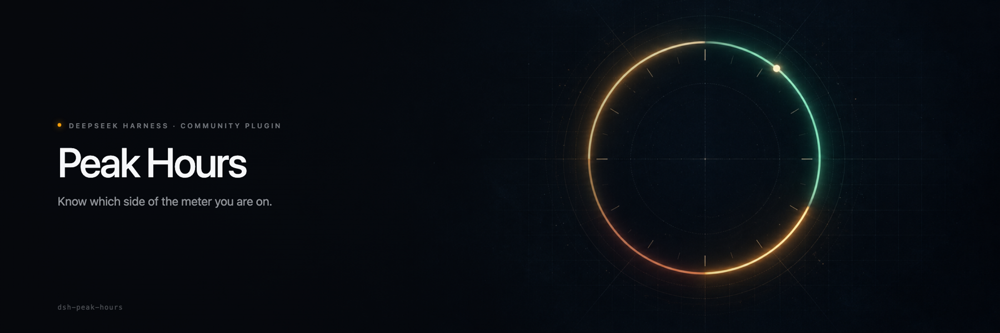
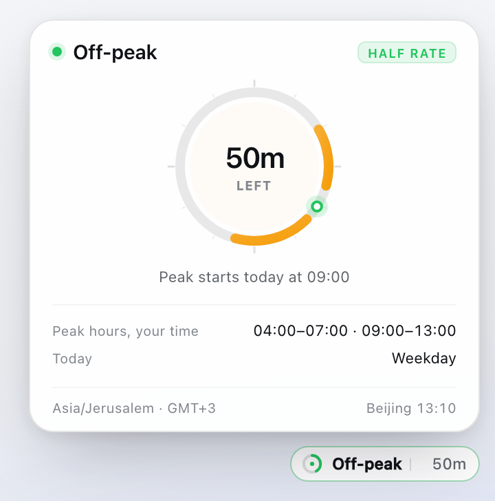
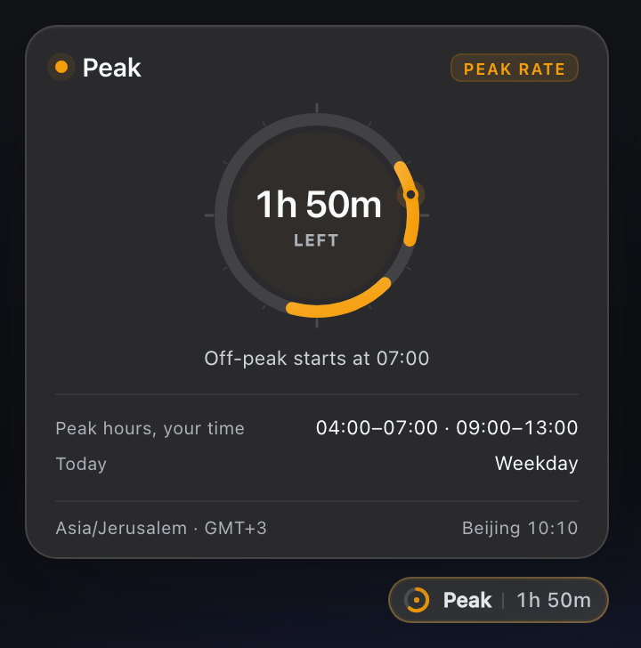
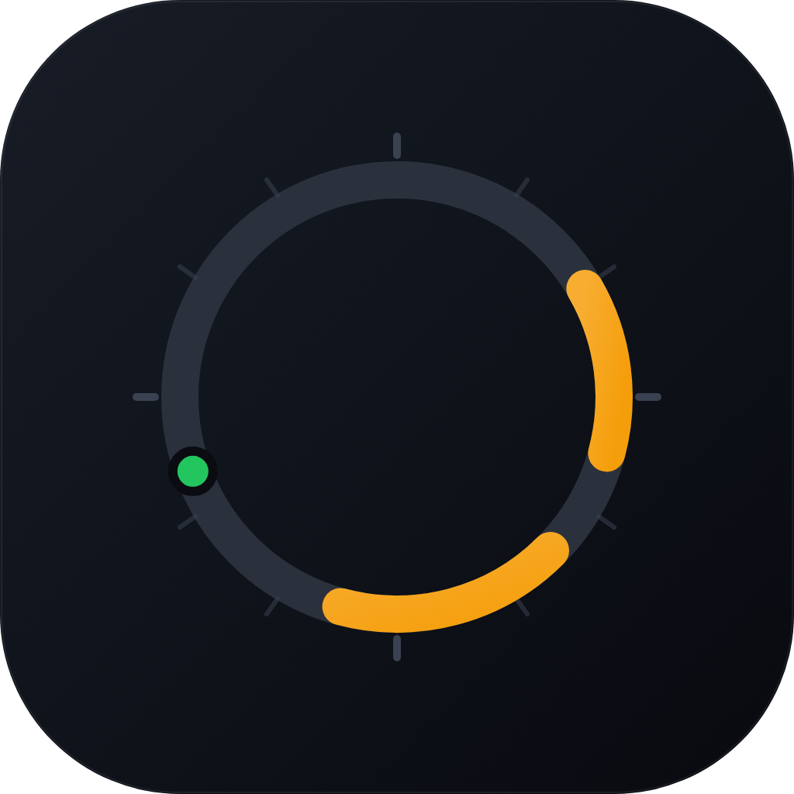

<div align="center">

  

  **DeepSeek charges half price outside peak hours. This tells you when that is.**

  <sub>COMMUNITY PLUGIN &nbsp;·&nbsp; NOT OFFICIAL &nbsp;·&nbsp; MIT &nbsp;·&nbsp; DSH 0.2.x</sub>

  <br /><br />

  [Install](#install) &nbsp;·&nbsp; [Use](#use) &nbsp;·&nbsp; [How it works](#how-it-works) &nbsp;·&nbsp; [Timezones](#timezones) &nbsp;·&nbsp; [FAQ](#faq)

</div>

<br />

> **This is a community plugin, not an official DeepSeek product.**
>
> Peak Hours is an independent project. It is not affiliated with, endorsed by,
> or supported by DeepSeek AI, and it is not part of DeepSeek Harness. DeepSeek
> Harness and DeepSeek are names and marks of their respective owners.

## Why this exists

DeepSeek's API has two prices. Off-peak costs half of the peak rate. The windows
are written in UTC, on a Beijing calendar, in a paragraph on the pricing page.

That is the correct way to define the policy and a terrible way to read it from
Tel Aviv at 17:35. You do the arithmetic in your head, guess, or notice the
difference on the invoice later.

Peak Hours puts one badge in the composer bar. It says **Peak** or **Off-peak**
and how long the current window has left. Click it and you get the day as a
clock face, the schedule in your own timezone, and the exact moment the price
changes.

| | Peak | Off-peak |
| --- | --- | --- |
| Rate | full price | **half price** |
| UTC | 01:00–04:00, 06:00–10:00 | every other hour |
| Beijing | 09:00–12:00, 14:00–18:00 | nights, weekends, holidays |
| Days | Monday to Friday, not a Chinese public holiday | weekends and holidays, all day |

The plugin answers one question: which column am I in, and for how much longer.

## What it looks like

<p align="center">
  
  
</p>

<p align="center">
  <sub>Light and dark. The 24-hour face is your local day, with every peak window in amber and a marker for now.</sub>
</p>

The badge is small enough to ignore while you type. The ring drains over the
current window, so a glance tells you whether you have minutes or hours.

| | Off-peak | Peak |
| --- | --- | --- |
| Badge accent | green | amber |
| Ring | drains over the off-peak stretch | drains over the peak window |
| Panel chip | half rate | peak rate |

## Install

**Requires [DeepSeek Harness](https://github.com/deepseek-ai/deepseek-harness)
0.2.x** (tested on `0.2.1-rc.1`). Desktop and the Web UI are both supported.

The repository is the install unit. The package inside it is `dsh-peak-hours`;
the spec you paste is the GitHub address.

### 1. From the Plugins page (recommended)

1. Open the sidebar and choose **Plugins**.
2. Install a plugin and paste:

   ```text
   github:Adolanium/dsh-peak-hours
   ```

3. Install it. The bundle is enabled by default.
4. Refresh the DeepSeek Harness window (`Ctrl+R` / `Cmd+R`). The browser half
   loads lazily, so the badge appears after a reload.

No build permission is needed. The package ships plain JavaScript, has no
`prepare` script, and has no runtime dependencies.

### 2. With the `dsh` CLI

```sh
dsh plugin --profile desktop add github:Adolanium/dsh-peak-hours
```

`dsh` appends the bundle to the profile's `dsh.profile.bundles` because the
package declares `dsh.bundle`. Start DeepSeek Harness afterwards, then refresh
the window.

Pin the install to this release:

```sh
dsh plugin --profile desktop add github:Adolanium/dsh-peak-hours#v0.1.0
```

Remove it with:

```sh
dsh plugin --profile desktop remove dsh-peak-hours
```

### 3. From a checkout (development)

```sh
git clone https://github.com/Adolanium/dsh-peak-hours.git
cd dsh-peak-hours
./scripts/install-dev.sh
```

That links the checkout into `~/.dsh/profiles/desktop/node_modules` and adds the
bundle to the profile manifest, with a timestamped backup. Undo it with
`./scripts/uninstall-dev.sh`.

> The profile reloads configuration live, so the Host half activates without a
> restart. The browser half is loaded lazily: refresh the window for code
> changes.

## Use

Open any session. The badge sits in the composer bar, just left of the model
selector.

**The badge** shows the current window and the time left. It updates every
second, so the number you read is the number that is true.

**The panel** opens on click:

- the countdown, to the second;
- a 24-hour face of your local day, with peak windows in amber and a marker for
  now;
- the next change, for example `Peak starts today at 09:00`;
- the full schedule converted into your timezone, and the reason for today
  (`Weekday`, `Weekend`, or a holiday name);
- your timezone with its current offset, and the same moment in Beijing.

`Esc` or a click outside closes it. The badge keeps ticking while the panel is
closed.

Below one hour the panel counts seconds. Above one hour it counts minutes, which
is what you want when the answer is "two days".

## How it works

```text
your clock
    │
    ├─ Beijing calendar: weekday? public holiday?
    ├─ UTC windows: 01:00–04:00, 06:00–10:00
    ▼
countdown  +  local-day arcs
```

Three rules keep it honest:

1. **The policy is evaluated where it is written.** Peak windows are UTC
   instants. Whether a day is a peak day is a Beijing calendar question, so the
   plugin asks the Beijing calendar, not your `Date` object. A Friday 23:00 in
   Los Angeles is a Saturday in Beijing, and the badge says so.
2. **The rendering is yours.** Those instants are formatted with `Intl` in your
   own zone. Daylight saving time is handled by the platform, not by fixed
   offsets, and a 23 or 25 hour local day still draws correctly on the face.
3. **No zone, no pretending.** If the runtime cannot resolve a timezone, the
   plugin falls back to Beijing time and labels the panel `Beijing time ·
   fallback`. It never presents a guess as your local time.

The badge is one registration in `conversation.input.right`. It uses the
Harness theme tokens for every surface and text color, so it follows your
theme, including custom ones. There is no Host route, no network request, and
no state written to disk.

## Timezones

Peak windows are the same instants everywhere. The clock times are not:

| Your zone | Peak hours, local time |
| --- | --- |
| Beijing (UTC+8) | 09:00–12:00 · 14:00–18:00 |
| Jerusalem (UTC+3) | 04:00–07:00 · 09:00–13:00 |
| Kolkata (UTC+5:30) | 06:30–09:30 · 11:30–15:30 |
| Los Angeles (UTC-7) | 18:00–21:00 · 23:00–03:00 |

The second Los Angeles window crosses local midnight. The panel prints it as
`23:00–03:00` and the day face shows the part that falls inside today, because
that is what your clock does.

The timezone comes from the operating system or browser. It is read when the
Harness window loads, so after a flight or a manual timezone change, refresh the
window.

## The holiday calendar

Chinese public holidays are off-peak all day. The plugin ships the official 2026
schedule from
[国办发明电〔2025〕7号](https://www.gov.cn/zhengce/content/202511/content_7047090.htm):

| Holiday | Dates |
| --- | --- |
| New Year's Day | 1 January – 3 January |
| Spring Festival | 15 February – 23 February |
| Qingming | 4 April – 6 April |
| Labour Day | 1 May – 5 May |
| Dragon Boat | 19 June – 21 June |
| Mid-Autumn | 25 September – 27 September |
| National Day | 1 October – 7 October |

Make-up workdays (14 February, 28 February, 9 May, 20 September, 10 October in
2026) are weekends. The policy is Monday to Friday, so they stay off-peak and the
plugin does not treat them as working days.

The State Council publishes the next year's schedule each November. When it
does, add the spans to `HOLIDAYS` in [`lib/client.js`](lib/client.js) and update
the count in the test. Until then, a date outside the table follows the weekday
rule.

## What it does not do

- It does not change what you pay or which model you use.
- It does not call the DeepSeek API, and it does not store your usage.
- It does not add a route, an event, or a background process.
- It does not need a build step, a bundler, or a dependency.

## Compatibility

- DeepSeek Harness **0.2.x** (tested on `0.2.1-rc.1`, Desktop and Web).
- macOS, Windows, and Linux.
- Chromium 111 or newer, for `color-mix()` in the theme surfaces.
- One public slot: `conversation.input.right`. Theme tokens only; no Harness
  primitives, no monkey-patching, no DOM outside the component.

Developer preview means breaking changes. If a release moves the slot, the
plugin fails soft: the registration disappears and the rest of the composer
keeps working.

## Development

```sh
node --test
```

Thirteen tests, no dependencies:

- **Engine** (`test/engine.test.mjs`) covers window boundaries, the Friday to
  Monday carry, holidays, timezone conversion, the fallback, 25-hour DST days,
  and duration formatting. Every case uses a fixed instant, so the suite is
  deterministic.
- **Wiring** asserts the locale dictionaries and the slot registration that the
  browser half contributes.

The preview images in this README are rendered from the shipped component with
the Harness theme tokens. The banner art is generated with an image model and
composed with the wordmark.

## FAQ

**Does this change my bill?**
No. It reads the clock and the published policy. Billing stays with DeepSeek.

**Why is peak at 04:00 for me?**
Because the policy is written in UTC. 01:00 UTC is 04:00 in Jerusalem. The panel
shows both the local schedule and the Beijing time it came from.

**Why did the countdown jump by an hour?**
Daylight saving time ended or started in your zone. The windows are fixed
instants; your wall clock is not.

**I'm travelling. Will it follow me?**
It follows the timezone your operating system reports when the window loads.
Refresh after the change.

**Why does it say Beijing time?**
The runtime did not expose a usable timezone. The plugin falls back to Beijing
rather than showing you the wrong local time.

**What about 2027?**
The official schedule is not published yet. The weekday rule still applies. Add
the new spans when the notice lands, or open an issue and I will.

**Can I turn it off?**
Remove the plugin from the Plugins page, or disable the `peak-hours` bundle in
the profile patch. The composer returns to its stock layout.

**Does it work in the browser-only Web UI?**
Yes. It computes everything locally, so there is no Host route to reach.

## License

[MIT](LICENSE).

<br />

<div align="center">
  
  <br />
  <strong>Peak Hours</strong><br />
  <sub>A community plugin for DeepSeek Harness. Not official.</sub>
</div>

<br />

> **Community project**
>
> Peak Hours is an independent community plugin. It is not affiliated with,
> endorsed by, sponsored by, or officially associated with DeepSeek AI or the
> DeepSeek Harness project. DeepSeek, DeepSeek Harness, and `dsh` are names and
> marks belonging to their respective owners.
